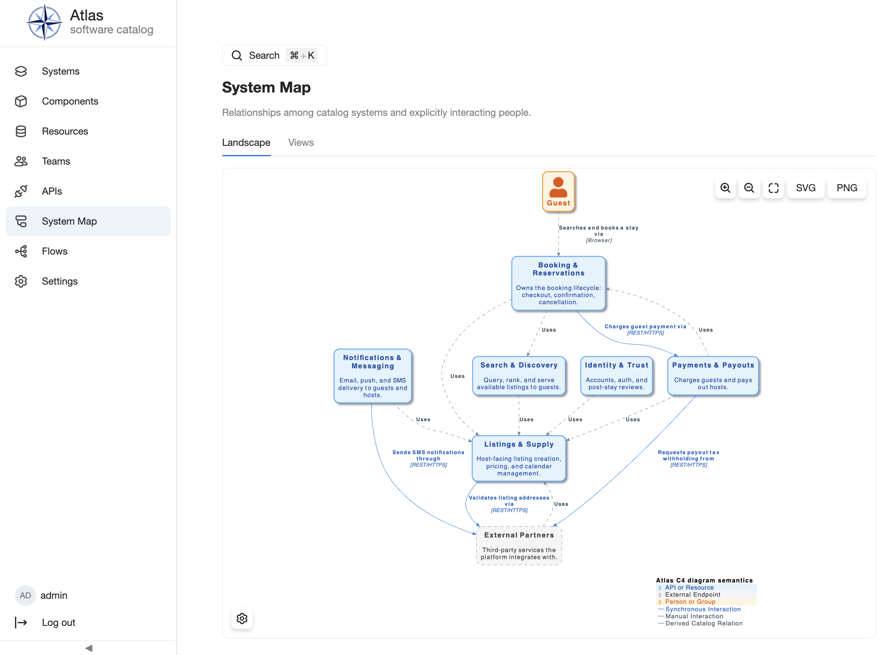
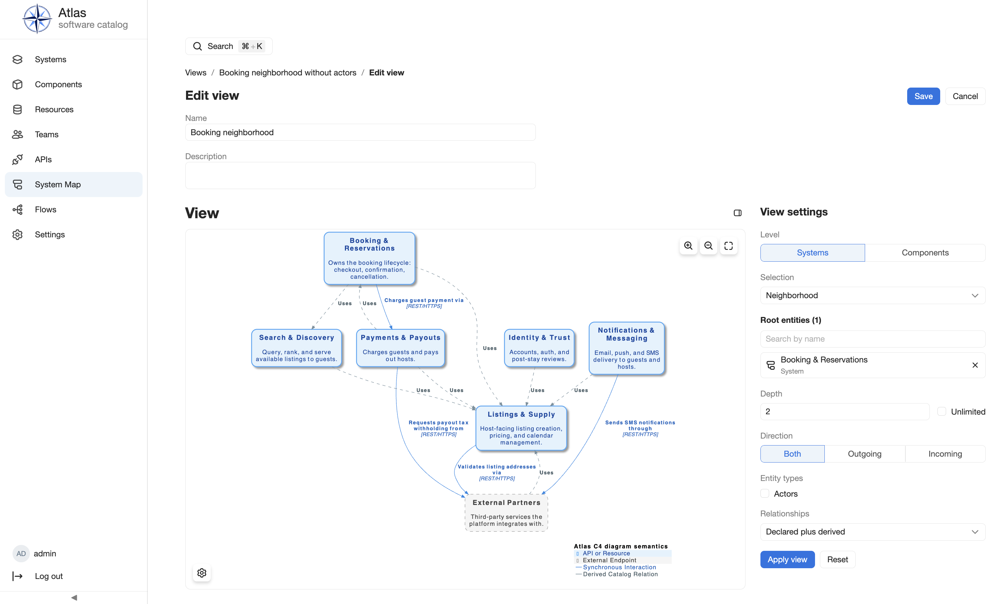

# C4

`atlas.c4` renders a System Landscape and diagrams for Systems and Components
that support diagrams. It requires `atlas.standard-catalog` and targets the
`architecture.subject.v1` capability. It does not own an Entity Kind.

## Enablement, configuration, and permissions

Select C4 with Standard Catalog, then compose the distribution. C4 has no
secret. Its plugin configuration selects the PlantUML renderer and sets
`maxNodes`, the largest number of nodes a custom view may show (default `50`;
boundary frames do not count). A custom view over the limit is rejected with an
error instead of being truncated. Viewing requires `atlas.c4.diagram.read`; the
central policy evaluator checks this permission. Saving views uses
`atlas.c4.view.create` and `atlas.c4.view.delete`; any signed-in user who is not
read-only may create, edit, and delete views, whoever created them.

## Workflows

Open **System Map** in the navigation for the catalog-wide System Landscape.

On a System or Component detail page, open its diagram tab when available for
the same entity's scoped System Context or System Architecture view. Use the
controls to choose a layout and show or hide the title, legend, selected
label, person sprite, and stereotypes. The UI stores these preferences
locally. Download the current rendering as SVG or PNG. For how diagrams
relate to authored relationships, see [Use feature-specific
views](../using-atlas/use-feature-views.md).

## Views

The **Views** tab of System Map lists saved views: named slices of the catalog that each draw a
diagram of part of the architecture instead of the whole landscape. Search by name, sort by name,
and page through the list. Open a view to see its diagram and export it as SVG or PNG. **Create
view** and the **Edit** and **Delete** row actions are hidden for read-only users; deleting asks for
confirmation and never touches the catalog entities a view refers to.

Everyone who can read diagrams sees every view, and any other user who can write may edit or delete
it. To share a view, send the address of its page (`/system-map/views/<id>`). A view stores its
rules and entity ids, not a snapshot: if the catalog changes, the same view draws the changed
result, and it is drawn with the viewer's own display preferences. If an entity it refers to has
been removed, the view page names it and does not draw a partial diagram; edit the view, remove the
entity, and save.

### The editor

**Create view** opens the editor with the preview on the left and the **View settings** panel on
the right. The panel is collapsible (open by default) and holds the name, a description, and the
settings below. Settings are edited as a draft and take effect on the preview only when you choose
**Apply view**; **Save** stores the draft whether or not you applied it. Reset restores the draft
to what was loaded. Leaving the editor with unsaved changes asks for confirmation. The name is
required and must be unique, ignoring case.

- **Level.** *Systems* draws Systems; *Components* draws Components, Resources, and APIs, which may
  belong to different Systems, grouped in one boundary per System (a Resource without a System is
  drawn outside any boundary). A selection cannot mix the two levels.
- **Selection.** *Selected entities only* draws exactly the chosen entities and the relationships
  between them; a chosen entity with no such relationship stays visible as an unconnected node.
  *Neighborhood* starts from root entities and adds neighbors up to a depth (a positive number or
  Unlimited) in a direction (both, outgoing, incoming). At the Systems level depth counts hops
  between Systems. Entity types you switch off are neither added nor used as stepping stones, but
  chosen roots always stay visible.
- **Actors.** Kinds that declare the `architecture.actor.v1` capability (Users and Groups) appear
  only through declared relationships, never through ownership. In a Neighborhood they are leaves:
  shown next to the entity they connect to, but not followed further unless chosen as a root.
- **Relationships.** *Declared only* uses authored Architecture Relationships. *Declared plus
  derived* adds the relationships derived from catalog data, and a declared relationship replaces a
  derived one between the same two ends.
- **Limit.** A view may show at most `maxNodes` nodes (default 50, set in the `atlas.c4` plugin
  configuration; boundary frames are not counted). A larger view is rejected with a message naming
  the limit and the resulting count rather than truncated; reduce the depth or the selection.
- **Layout and display options** (layout, title, legend, and so on) come from the diagram settings
  button on the diagram, not from the view settings.
- **Entry points.** The System Architecture and Component diagram tabs have an **Open in view
  builder** button that opens the editor on a new view with that entity as a Neighborhood root at
  depth 1, in both directions, with declared relationships and all entity types, and draws it
  straight away.

## API, operations, and extensions

Diagram endpoints return SVG by default and support PNG and attachment
downloads. Views are managed under `/api/plugins/atlas.c4/views/` (create, list,
read, update, delete), and a saved view renders at
`GET /api/plugins/atlas.c4/views/{id}/diagram/`. The editor previews an unsaved
draft with `POST /api/plugins/atlas.c4/diagrams/custom/`, which takes the view
settings as a JSON body; settings in the query string are ignored. Diagram
requests answer 400 for invalid settings, 404 for an unknown view or a removed
entity (the body names it), and 422 when the node limit is exceeded, each with a
JSON body. Use the running [generated HTTP API reference](../api-reference/index.md)
for exact parameters. Rendering uses local PlantUML-compatible payloads.
C4 has no scheduled jobs. Its one migration creates the saved views table. To make
another kind diagram-capable, authors declare the documented capability
rather than depend on a C4 model; see
[Entity kinds and facets](../plugin-development/entity-kinds-and-facets.md).

## Limits and troubleshooting

Only supported diagram targets and views render. If a tab is missing, the
plugin may be absent, the entity may lack the capability, or the reader may
lack permission. A rendering error indicates a local rendering dependency or
unsupported data condition. Inspect backend logs and the [troubleshooting
guide](../deployment/troubleshooting.md). Diagrams never edit the catalog: change the catalog
entities and declared relationships that supply them. Only saved views are
writable.

## Next steps

Continue with [catalog detail inspection](../using-atlas/inspect-entity-details.md),
[Operating Atlas](../operating-atlas/index.md), [architecture concepts](../concepts/system-shape.md),
[plugin contributions](../plugin-development/extension-points.md), and the
[generated HTTP API reference](../api-reference/index.md).
